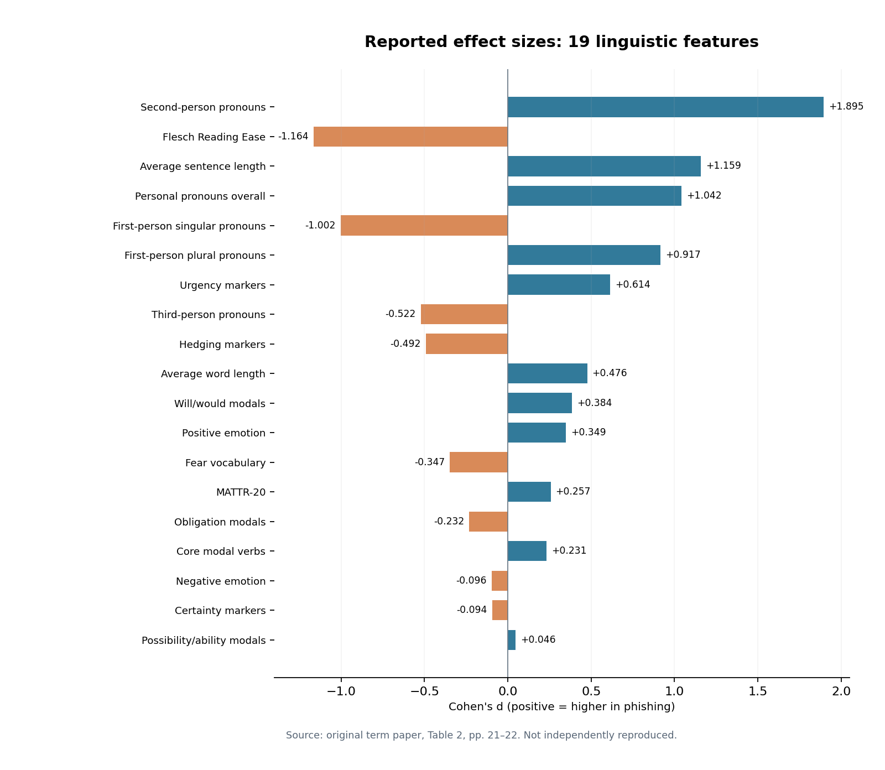

# Linguistic Differences Between Phishing and Legitimate Emails

**A feature-based NLP and text analytics study | Master's term paper (2026)**

> **What this is:** An evidence-grounded research portfolio repository summarizing an existing 48-page master's term paper and providing a newly written, runnable **illustrative feature-analysis pipeline**. It is **not** a phishing-detection classifier, a newly reproduced empirical study, or a peer-reviewed publication.

## Research question

How do phishing and legitimate emails differ in interpersonal address, stance, urgency, affective language, and style, and which differences are statistically detectable in the studied corpus?

## Key findings reported in the original paper

| Indicator | Reported result |
|---|---|
| Original human-authored email bodies | 2,000 (1,000 each class) |
| Final English email sample | 1,148 (695 legitimate; 453 phishing) |
| Linguistic / stylistic features | 19 |
| Significant after Holm correction | **16/19** |
| Balanced robustness subset | 453 phishing + 453 legitimate |
| Largest reported Cohen's d | Second-person pronouns, **+1.895** |
| Other large contrasts | Flesch Reading Ease, **-1.164**; average sentence length, **+1.159** |

Positive Cohen's d indicates higher average scores in phishing messages. The numerical results above were **transcribed from the supplied manuscript** and cannot be independently recomputed without the original email-level data and scripts. See [reported data](data/reported_feature_results.csv) and [provenance note](REPORTED_RESULTS_NOTE.md).



## Original study: five stages

1. **Source and sample.** Selected the human-authored `legit.csv` and `phishing.csv` subsets of Francesco Greco's *Human-LLM Generated Phishing-Legitimate Emails* dataset (1,000 emails per category).
2. **Clean and filter.** Removed duplicates and, after automated + manual language review, excluded non-English and very short texts; retained 1,148 email bodies.
3. **Extract linguistic features.** Counted pronouns, modal forms, certainty/hedging, urgency and NRC emotion words per 100 tokens; computed sentence length, word length, MATTR-20 and Flesch Reading Ease.
4. **Compare groups.** Used independent Welch t-tests, Holm correction for 19 comparisons, and signed Cohen's d; repeated comparisons on an equal-sized 453/453 subset (seed 42).
5. **Interpret.** Discussed group-level patterns through Interpersonal Deception Theory, while noting corpus, feature and generalization limitations.

No phishing classifier was trained or evaluated in the original study.

## Run the new illustrative demonstration

Requirements: Python 3.10+ (SciPy for group comparisons); **no private emails required**.

```bash
python -m venv .venv
# Windows: .venv\Scripts\activate
# Linux/macOS: source .venv/bin/activate
pip install -r requirements.txt
# Linux/macOS:
PYTHONPATH=src python -m phishing_language.cli demo
PYTHONPATH=src python -m unittest discover -s tests -v
# Windows PowerShell (without environment activation):
# $env:PYTHONPATH="src"
# python -m phishing_language.cli demo
# python -m unittest discover -s tests -v
```

The demonstration uses **8 invented emails**, calculates linguistic counts and sample group comparisons, and writes `demo_output/`. **These outputs have no relationship to the 1,148-email historical study.**

For authorized local CSV files with `id,label,text` columns:

```bash
PYTHONPATH=src python -m phishing_language.cli extract --input data/raw/your_emails.csv --output output/features.csv
PYTHONPATH=src python -m phishing_language.cli compare --input output/features.csv --output output/statistics.csv
```

The optional `--nrc-lexicon /private/path/to/NRC-Emotion-Lexicon-Wordlevel-v0.92.txt` adds three emotion features. Obtain it under the [NRC license](https://www.saifmohammad.com/WebPages/NRC-Emotion-Lexicon.htm); **do not redistribute it**. Undefined statistical tests remain `NaN` after Holm correction; the full family size is retained for the remaining tests. The new code includes approximate sentence segmentation and syllable estimation, not the original paper's exact preprocessing; findings from it must not be called a full replication.

## Repository layout

- `src/phishing_language/`: independently written feature extraction, statistical functions and CLI
- `tests/`: unit tests for extraction, mathematics and provenance
- `data/reported_feature_results.csv`: thesis Table 2 values, **reported only**
- `data/demo_emails.csv`: fabricated example email texts
- `figures/`: visualizations of transcribed historical summary statistics
- `docs/PROJECT_REPORT.pdf`: concise three-page report, plus editable Markdown
- `docs/METHODOLOGY_AND_LIMITATIONS.md`: what can and cannot be reproduced
- `docs/DATA_AND_LICENSING.md`: external source restrictions
- `research/ORIGINAL_THESIS_RECORD.md`: supplied manuscript provenance

## Scope and caveats

- Original 48-page master's term paper (author stated in supplied title page: **Adil Hussain**, HSE University, 2026).
- The full thesis PDF is intentionally omitted pending institutional/rights/privacy clearance. The source email texts, original scripts, NRC lexicon and intermediate cleaning logs were not included in the materials provided for GitHub preparation.
- Differences are group-level observations, not universal signatures of deception or safe inputs to a security product.
- The public code is a newly built *illustrative companion* and does not reproduce the paper's 19 statistical estimates.

Read the [project report](docs/PROJECT_REPORT.pdf), [reproducibility limitations](docs/METHODOLOGY_AND_LIMITATIONS.md), and [publication checklist](docs/PUBLICATION_CHECKLIST.md). Adil Hussain ([happyadilh](https://github.com/happyadilh)) confirmed sole authorship and authorized public release of this companion under the [MIT License](LICENSE). See [license scope](LICENSE_NOTICE.md) and [citation](CITATION.md).
