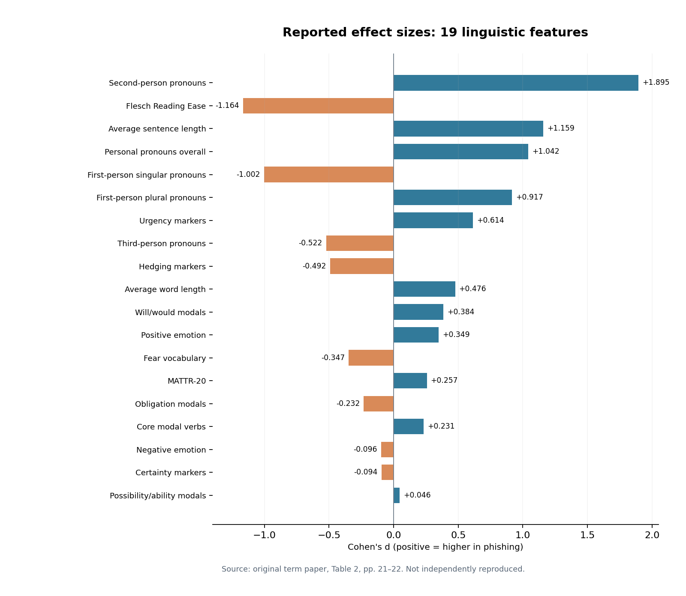

# Linguistic Differences Between Phishing and Legitimate Emails

**Concise project report | Corpus-based NLP and text analytics | Master's term paper (2026)**

## Purpose and research questions

The study investigates whether phishing and legitimate emails differ in pronoun use, modality, hedging, certainty, urgency, emotional vocabulary, lexical diversity and readability. It interprets group-level contrasts through Interpersonal Deception Theory. The study is **not a phishing classifier** and does not report classification accuracy.

## Data and workflow, step by step

1. **Select data.** The paper describes 2,000 human-written English email bodies (1,000 legitimate / 1,000 phishing), selected from the *Human-LLM Generated Phishing-Legitimate Emails* collection; the synthetic LLM-generated part of the source dataset was not analyzed.
2. **Deduplicate and filter.** Normalize Unicode/case/whitespace for deduplication, retaining original bodies. Deduplication yields 1,193 unique messages (701 legitimate / 492 phishing). Language detection with manual review excludes 36 non-English items, and a 20-English-word minimum removes nine more. The final sample contains 1,148 emails: 695 legitimate and 453 phishing.
3. **Extract 19 features.** Compute four pronoun groups and overall personal pronouns, core and subgrouped modals, hedging, certainty, urgency, NRC positive/negative/fear vocabulary, average sentence/word length, MATTR-20 and Flesch Reading Ease. Count measures are normalized per 100 words.
4. **Test and quantify.** Compare phishing and legitimate groups using Welch's two-sample t-test, Holm adjustment across 19 comparisons (α = 0.05), and signed Cohen's d (phishing minus legitimate).
5. **Robustness check.** Repeat group comparisons on a balanced 453/453 subset, with 453 legitimate messages chosen by fixed random seed 42.
6. **Interpret.** Discuss observed linguistic differences in relation to sender positioning, recipient orientation and persuasive urgency, without treating individual features as universal indicators of deception.

## Reported results

The original paper reports **16 of 19** features significant after Holm correction. Second-person reference was especially higher in phishing messages (means 5.726 vs 1.191 per 100 words; reported d = +1.895). Urgency markers were higher in phishing (0.448 vs 0.026; d = +0.614), with longer average sentences (19.524 vs 9.196 words; d = +1.159). Legitimate emails had higher Flesch Reading Ease (67.847 vs 48.993; d = −1.164) and more first-person singular reference (1.982 vs 0.211; d = −1.002). Certainty, negative emotion and possibility/ability modals were not statistically significant after adjustment. The paper reports that the same 16 features remained significant in its balanced subset.

*Figure: Table 2 data transcribed from the submitted thesis, pp. 21–22; this is not an independently reproduced result.*

## GitHub implementation and reproduction

The repository includes a new Python companion with a transparent feature extractor and statistical comparison utilities. It has a fictional eight-email demo and 12 source-code unit tests. `python -m phishing_language.cli demo` produces demo tables after installing dependencies and setting `PYTHONPATH=src`. The demo is **not the historical study**. A licensed local NRC Emotion Lexicon TSV is optional for emotion features and must not be distributed.

## Limitations and conclusion

The original email-level CSVs, scripts, lexicon snapshot and cleaning logs were **not supplied**; historical results cannot be independently recomputed or exactly replicated from this repository. The new extractor's sentence splitting and syllable counts are approximations. Source sampling, genre composition and dataset labels can affect comparisons; normalizing per 100 words does not remove all confounds. No detection-performance metrics were measured. The repository is a transparent **applied-linguistics research showcase** with an illustrative implementation, not a peer-reviewed paper or security detection product.

**Source:** Adil Hussain (2026), *Linguistic Differences Between Phishing and Legitimate Emails: A Feature-Based NLP and Text Analytics Study*, HSE University master's term paper (48 pp.). Authorship and permissions should be confirmed before making the full thesis public.
